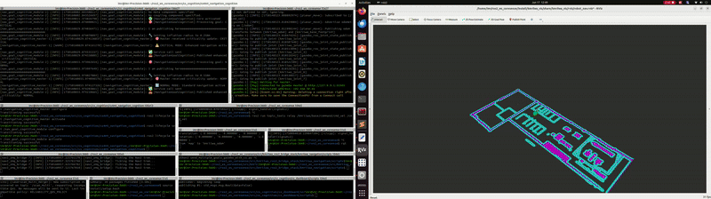

# cs4mt_navigation_cognition

Use case of the [cs4home architecture prototype](https://github.com/CoreSenseEU/cs4home_architecture) focused on the cognitive module of navigation cognition perception.

## Installation
### Only if not already installed
```bash
sudo apt-get install ros-humble-rclcpp-cascade-lifecycle*
sudo apt-get install ros-humble-ament-cmake-clang-format
sudo apt-get install ros-$ROS_DISTRO-behaviortree-cpp-v3
```

```bash
cd ~/ros2_ws/src
git clone -b humble https://github.com/CoreSenseEU/cs4home_architecture.git
git clone -b humble-devel https://github.com/fmrico/cascade_lifecycle.git
git clone https://github.com/KeerthiSagarSN/cs4mt_navigation_cognition/
vcs import --recursive < cs4home_sound_project/thirparty.repos
cd ~/ros2_ws
colcon build --symlink-install
```
## Creating a Cognitive Module

Each cognitive module is defined through configuration and implemented using the base classes provided by the architecture.

### 1. Define the module in YAML

Edit the file:

`cs4mt_navigation_cognition/config/params.yaml`

Example:

```yaml
navigation_cognition_master:
  ros__parameters:
    flows: [nav_goal_cognitive]
    nav_goal_cognitive: [nav_goal_cognitive_module]

nav_goal_cognitive_module:
  ros__parameters:
    core: nav_goal_cognitive_core
    afferent: nav_goal_cognitive_input
    efferent: nav_goal_cognitive_output
    meta: ""
    coupling: ""
    
    # Required cognitive processing parameters (for the core component)
    cognitive_processing_interval: 1.0
    goal_persistence_threshold: 3.0
    criticality_confidence_threshold: 0.8
    
    # Required inflation radius parameters (for the efferent component)
    normal_inflation_radius: 0.55 #0.55
    critical_inflation_radius: 0.25 #0.25
    recovery_inflation_radius: 0.30 #0.15
    
    nav_goal_cognitive_input:
      topics: ["/critical_goal"]
      types: ["std_msgs/msg/Bool"]
    
    nav_goal_cognitive_output:
      topics: ["/goal_criticality"]
      types: ["std_msgs/msg/Bool"]
    # ============================================
    # PROPORTIONAL DISTANCE-BASED REDUCTION
    # ============================================
    use_proportional_reduction: true   # Enable distance-based scaling
    
    # Distance at which to start reducing radius (meters)
    reduction_start_distance: 0.5      # Start reducing when closer than this
    
    # Minimum distance for maximum reduction (meters)
    reduction_end_distance: 0.2        # Full reduction applied at this distance
    
    # Maximum reduction percentage (0.0 - 1.0)
    # 0.5 = reduce radius by 50% when at goal
    # 0.7 = reduce radius by 70% when at goal
    max_reduction_percentage: 0.95      # Reduce by 60% at closest point
    
    # Smoothing
    radius_update_rate: 0.08           # Smoothing factor (higher = faster response)
    min_radius_change_threshold: 0.02  # Min change to trigger update (meters)
```

Fields:

- `core`: name of the main processing node
- `afferent`: input handler (subscribes to topics)
- `efferent`: output handler (publishes results)
- `meta`: module metadata manager
- `coupling`: logic that connects with other modules


Each component is managed as a ROS 2 Lifecycle Node and instantiated according to the YAML configuration.

# Launch file for basic set service functionality for reducing inflation radius

```bash
ros2 launch cs4mt_navigation_cognition cs4mt_navigation_cognition.launch.py
```
# Manual activation of lifecylce node  here - Navigation cognitive module
```bash
ros2 lifecycle set /nav_goal_cognitive_module configure
ros2 lifecycle set /nav_goal_cognitive_module activate
```
# Manual activation of lifecylce node  here - Navigation cognitive Master
```bash
ros2 lifecycle set /navigation_cognition_master configure
ros2 lifecycle set /navigation_cognition_master activate
```
## ----------------------------------- Agile Manufacturing Testbed ------------------------------

## Simulator

KMR-iiwa mobile manipulator using gazebo and nav2:

```bash
cd ~/ros2_ws/src
git clone https://github.com/KeerthiSagarSN/kmriiwa_ros2_bridge_stack
cd ~/ros2_ws
colcon build --symlink-install
```
## Launch dependencies for Mobile robot using Gazebo using KMR-IIWA
#### The commands are already listed within the main repo- only relevant launch commands are listed below
```bash
ros2 launch kmriiwa_simulation gazebo_coresense.launch.py
```
```bash
ros2 run tf2_ros static_transform_publisher --x 0 --y 0 --z 0 --qx 0 --qy 0 --qz 0 --qw 1 --frame-id map --child-frame-id kmriiwa_odom & ros2 run tf2_ros static_transform_publisher --x 0 --y 0 --z 0 --qx 0 --qy 0 --qz 0 --qw 1 --frame-id kmriiwa_odom --child-
frame-id kmriiwa_base_footprint
```
```bash
ros2 launch kmriiwa_navigation laserscan_merge.launch.py
```
```bash
ros2 run topic_tools relay /kmriiwa/base/command/cmd_vel /cmd_vel
```
```bash
ros2 launch kmriiwa_navigation kmr_robot_navigation_with_cs.launch.py
```
## Initialize pose in rviz

## Send goals for robot in Gazebo
```bash
cd /kmriiwa_navigation/scripts
python3 send_multiple_goals_gazebo_with_cs.py
```

## Basic functionality of setting inflation radius based on goal criticality


## ----------------------------------- Manufacturing Inspection Testbed ------------------------------
## Simulator

Ridgeback Robot with Gazebo and Rviz2:

```bash
cd ~/ros2_ws/src
git clone [https://github.com/KeerthiSagarSN/kmriiwa_ros2_bridge_stack](https://github.com/CoreSenseEU/samxl_mobile_manipulator_testbed.git)
cd ~/ros2_ws
colcon build --symlink-install
```
## Launch Gazebo with Rviz

```bash
ros2 launch ros2_ridgeback_navigation_samxl ridgeback_simulation_launch.py
```
## Inflation Radius adaptation using Cognitive Module

```bash
cd ~/ros2_ws/src/cs4mt_navigation_cognition/scripts/
python3 coresense_navigation_goals_with_cs_samxl.py
```


